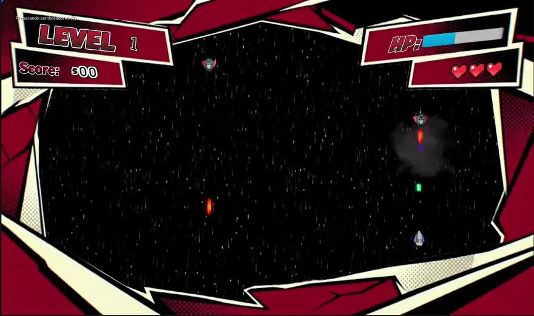
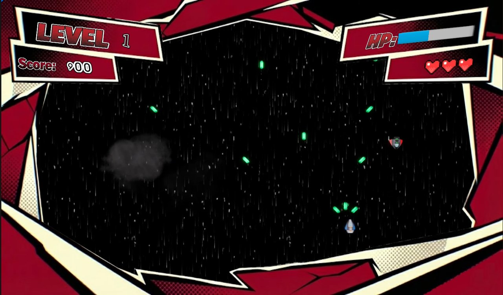
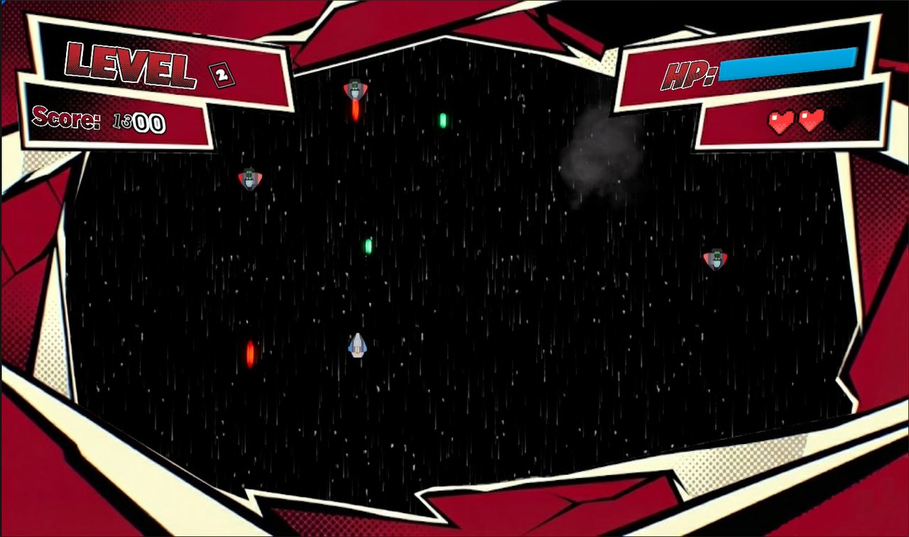

<div align="center">

# 🚀 Space Shooter (Unreal Engine)

**Shoot 'em up arcade infinito hecho con Blueprints: sobrevive el máximo tiempo posible mientras recoges power-ups de disparo, de cura y de vida**

[]()
[]()
[]()

</div>

---

## 📖 Sobre el proyecto

Un *space shooter* arcade que no termina: tu nave se enfrenta a enemigos que no dejan de aparecer, y tu objetivo es aguantar y subir la puntuación. Por el camino aparecen **power-ups** que mejoran el disparo, curan a la nave o suman una vida. No tiene menú: al abrirlo, estás directamente en la partida.

> 📌 **Proyecto académico** de la asignatura *Programación y Arquitectura de Videojuegos* del *Máster en Diseño y Desarrollo de Videojuegos* de la **UNIR**, hecho con Unreal Engine 5.5. El curso también incluyó un shooter distinto hecho con Unity: [2025_SpaceShooter_UnaiGB](https://github.com/unaigb/2025_SpaceShooter_UnaiGB).

---

## 🖼️ Capturas

<p align="center">
  
</p>

<p align="center">
  
  
</p>

<p align="center"><em>Dos momentos de una partida: el nivel y la puntuación arriba a la izquierda; la barra de vida y las vidas, a la derecha.</em></p>

---

## 🎮 Cómo se juega

- **Dispara** con la barra espaciadora y mueve la nave con el teclado.
- **Los enemigos** aparecen de forma aleatoria y disparan láseres. Hay varios tipos.
- **Recoge los power-ups** que aparecen: disparo triple, cura y vida extra, entre otros.
- **Controla tu estado** en el HUD: nivel, puntuación, barra de vida y vidas restantes.
- **Sube de nivel** a medida que avanzas: aparece un cartel *LEVEL UP* y el nivel del HUD aumenta.
- **Es infinito:** no hay un final. Cuanto más aguantes, mejor puntuación.

---

## ✨ Qué incluye

- **Todo en Blueprints:** la nave, los enemigos, los power-ups, el HUD y el modo de juego. El proyecto no tiene código C++.
- **Enemigos** de varios tipos con su propio generador aleatorio y disparos láser.
- **Power-ups** definidos con un tipo enumerado, con su propio efecto y sonido.
- **HUD** de estilo cómic con nivel, puntuación, vida y vidas, y un cartel de *LEVEL UP* al subir de nivel.
- **Explosiones, música y efectos de sonido** para disparos, curas y vidas extra.
- **Entrada con Enhanced Input** (acciones de movimiento y disparo).

---

## 🚀 Cómo ejecutarlo

**Requisitos:** [Unreal Engine 5.5](https://www.unrealengine.com/download) (Epic Games Launcher).

1. Clona el repositorio o descárgalo.
2. Haz doble clic en `UnaiGB_SpaceShooter.uproject` y abre el proyecto con Unreal Engine 5.5 (la primera vez compila *shaders* y tarda un rato).
3. El proyecto arranca en el nivel `Content/SpaceShooter/Level1`. Pulsa **Play**.

No hay una versión compilada publicada.

---

## 📂 Estructura del repositorio

```
UnaiGB_SpaceShooter/
├── Config/                       # Ajustes del proyecto (mapa por defecto, entrada...)
├── Content/
│   └── SpaceShooter/
│       ├── Players/              # La nave, el personaje y la munición
│       ├── Enemies/              # Enemigos, láseres y generador aleatorio
│       ├── Power-Ups/            # Power-up base y su tipo
│       ├── UI/                   # HUD y widget del juego
│       ├── Input/                # Acciones y contexto de entrada
│       ├── Sounds/ · Textures/ · Materials/
│       └── Level1                # Nivel de juego
├── Media/                        # Capturas y animación
└── UnaiGB_SpaceShooter.uproject
```

---

## 🖥️ Stack tecnológico

| Categoría | Herramientas |
| :--- | :--- |
| **Motor** | Unreal Engine 5.5 |
| **Lógica** | Blueprints |
| **Entrada** | Enhanced Input |

---

## 🎨 Créditos de terceros

Este repositorio incluye recursos de otros autores, que conservan sus propias licencias: el contenido de ejemplo de Unreal Engine, el pack *Axion Claymore*, una tipografía de menú inspirada en *Persona 5* y la música y los efectos de sonido, según el nombre de los ficheros.

---

## 👤 Autoría

**Unai García** — Máster en Diseño y Desarrollo de Videojuegos (UNIR)

- 🐙 GitHub: [@unaigb](https://github.com/unaigb)
